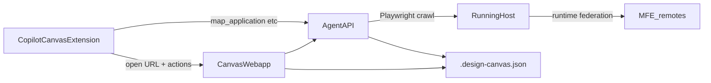

# Vista Canvas — Living Plan

We are building **Vista Canvas**: an AI-compatible design canvas — a shared visual work surface where a human and an agent can map a running host app, inspect flows and states, and focus a live screen — without treating chat as the only UI.

**Current scope:** runtime mapping of a running host (MFEs may load from CDN) + presentation in [GitHub Copilot Canvas Extensions](https://docs.github.com/en/copilot/how-tos/github-copilot-app/working-with-canvas-extensions). The mock bank is a personal testbed, not the product.

**Hosts:** Copilot Canvas Extension is the work target. The local webapp (`npm run dev` / `npm run start:web`) is the daily driver. Cursor MCP Apps remain an inline adapter only.

---

## Current scope

| In scope | Out of scope (until we decide otherwise) |
| :--- | :--- |
| Repo-agnostic canvas webapp | Canvas → agent inline code edit (removed) |
| Runtime mapping of a **running host** | Native mobile streams |
| Copilot Canvas Extension packaging | Structural / wireframe mode |
| Cursor MCP App as inline adapter | Auto-discovered fixtures |
| mock-bank-mfe as personal / mock testbed | Multi-repo MFE edit routing |
| Meso stills + live focus iframe | Source crawl of remote MFE repos |

Update this table when scope changes. Do not treat older sprint narratives as the roadmap.

---

## How we track

Keep **this file** as the single source of truth.

When finishing a slice:

1. Update **Current scope** and the [board](#board) outcome.
2. Add a row to the [decision log](#decision-log) if we learned something that changes direction.
3. Wait for explicit go-ahead before expanding scope.

---

## Board

| Slice | Title | Status | Outcome |
| :--- | :--- | :--- | :--- |
| 0–7 | Foundation through meso stills | Done | Two-repo canvas + mock bank; macro/meso; focus; fixtures; modules; Playwright stills |
| **9** | **Runtime mapping + Copilot canvas** | **Now** | Strip inline edit; Playwright host crawl → `.design-canvas.json`; Copilot `extension.mjs`; empty seed |
| — | Native mobile bridge | Later | `NativeStreamAdapter` |
| — | Structural mode & agent skill | Later | Wireframe toggle + portable `SKILL.md` |

---

## Decision log

| Date | Decision | Why it matters |
| :--- | :--- | :--- |
| 2026-11-21 | Two separate repos (tool vs target app). Never a monorepo. | The canvas must stay repo-agnostic; `mock-bank-mfe` is a testbed, not the product. |
| 2026-11-21 | Cursor MCP Apps are **inline-only**. | Primary surface is a local webapp shaped for Copilot `open()` → localhost URL. |
| 2026-11-21 | Iframes target the **shell** (`DESIGN_CANVAS_APP_ORIGIN`), not remote MFE ports. | Federation remotes load through the host (localhost or CDN). |
| 2026-11-22 | Meso = cached stills; live iframe = focus only. | Live meso iframes do not scale; stills keep overview instant. |
| 2026-11-23 | **Mapping is runtime-against-the-shell**, not source crawl of MFE repos. | Work hosts load remotes from CDN; the mapper only needs a reachable host URL + optional `federation.manifest.json`. |
| 2026-11-23 | **Inline canvas → agent edit removed.** | Focus is inspect + live preview. Code edits stay in the IDE / Copilot chat, not a docked composer. |
| 2026-11-23 | **Copilot is the presentation host** for the first work test. | Extension lives in `.github/extensions/vista-canvas/`; `open()` serves `http://127.0.0.1:4173`. |
| 2026-11-23 | Missing `.design-canvas.json` seeds an **empty** graph. | Topology comes from Map / agent actions, not a hard-coded Nordhavn seed. |
| 2026-11-23 | Crawl **collapses sibling entity URLs** into one parameterized screen. | `/accounts/everyday` + `/accounts/savings` → route `/accounts/:accountId`, one preview. Top-level routes stay distinct. |
| 2026-11-23 | Shared **chrome links → module hub `nav`**; path-child / local links → **`flow`**. | Menu destinations appear on every page; attributing them to the discovering screen created false sibling edges. |
| 2026-11-23 | Auth’d hosts use **`DESIGN_CANVAS_STORAGE_STATE`**; Copilot package root via **`DESIGN_CANVAS_HOME`**. | Staging login and copied extensions must not block the first work pass. |
| 2026-11-23 | Fixtures stay **curated**; Map remaps parents on `replace`. | States are not auto-discovered; agents attach via `add_fixture_node`. |

---

## Architecture

### Runtime mapping

1. Optional `GET {appOrigin}/federation.manifest.json` for remote names.
2. Playwright Chrome opens `/`, BFS same-origin in-app links (cap ~30 / depth 4).
3. Upsert screens + edges into `.design-canvas.json` (`merge` default, or `replace`).
4. Modules and fixtures stay curated; query-string fixtures are not crawled. `replace` remaps fixture parents onto surviving routes.

### Copilot bring-up (first work / mock-env test)

1. Clone `vista-canvas` + `mock-bank-mfe` (or point at the work host checkout).
2. Bank / host: run so the shell is reachable (mock: `npm run dev` → `:4200`).
3. Canvas: `npm install && npm run build`; set `DESIGN_CANVAS_TARGET` and `DESIGN_CANVAS_APP_ORIGIN`.
4. Open **this** repo in GitHub Copilot. Open **Vista Canvas**.
5. Ask Copilot to map the app, or press **Map**. Meso stills follow.

Chrome is required (`playwright` `channel: 'chrome'`). If Copilot is opened on a different repo, copy `.github/extensions/vista-canvas/` into that workspace or `~/.copilot/extensions/`, and set `DESIGN_CANVAS_HOME` to the vista-canvas clone.

---

## Instructions for Cursor / Copilot

1. Work within **current scope**. Do not revive the edit composer or `@cursor/sdk` edit bridge.
2. Two repositories (never nested):
   - **`vista-canvas`** — canvas engine, webapp, Copilot extension, MCP adapter.
   - **Target app** — host checkout with `.design-canvas.json` (mock-bank-mfe locally).
3. Durable canvas state lives in the **target repo** as `.design-canvas.json`.
4. After a slice, update this file’s board, scope table, and decision log.
