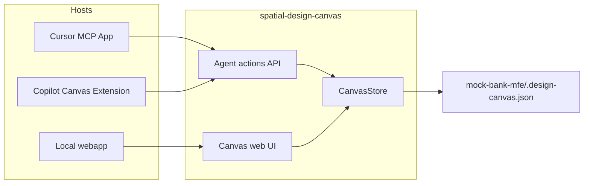
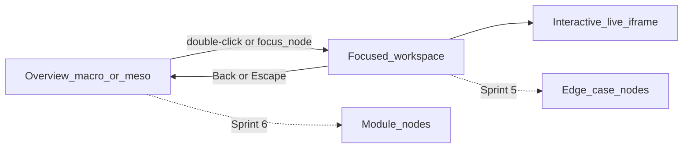
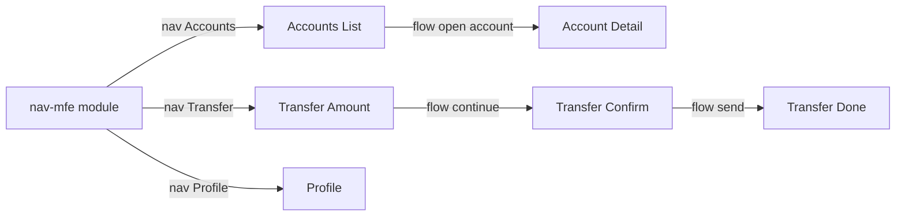

# Spatial Design Canvas — Living Plan

We are exploring an **AI-compatible spatial design canvas**: a shared visual work surface where a human and an agent can inspect flows, focus a screen, and iterate on live code — without treating chat as the only UI.

**North star:** the same canvas should run in [GitHub Copilot Canvas Extensions](https://docs.github.com/en/copilot/how-tos/github-copilot-app/working-with-canvas-extensions) at work. Copilot canvases are ordinary web apps: `createCanvas({ open })` serves `http://127.0.0.1:<port>`, and the agent talks to that surface through declared **actions** over shared state.

**Until then:** Cursor’s MCP Apps host only mounts widgets **inline** (no fullscreen). So `spatial-design-canvas` must ship a **real local webapp** as the primary surface. MCP Apps stay as one host adapter, not the product.

---

## Now / Next / Later

| | |
| :--- | :--- |
| **Now** | Sprint 8 — Cursor SDK edit bridge |
| **Last done** | Sprint 7 — Meso bitmap snapshots (hybrid renderer slice) |
| **Not yet** | Branching / drift, native streams, Copilot packaging, structural mode |

Update this table whenever a sprint starts or finishes. Do not 1-shot the rest of the roadmap.

### How we track

Keep **this file** as the single source of truth. Do not add a second tracker (`STATUS.md`, GitHub Projects, etc.) unless we outgrow one document.

When finishing a sprint:

1. Move it in the [board](#sprint-board) to **Done**, with a one-line outcome.
2. Add a row to the [decision log](#decision-log) if we learned something that changes later sprints.
3. Set **Now** to the next sprint and wait for explicit go-ahead.

When starting a sprint: rewrite **Now** and the sprint’s **Acceptance** so the session has a concrete finish line.

---

## Sprint board

| Sprint | Title | Status | Outcome |
| :--- | :--- | :--- | :--- |
| 0 | Two-repo foundation | Done | `spatial-design-canvas` + `mock-bank-mfe` (Nordhavn Bank host + 2 MFEs) |
| 1 | State graph & MCP App shell | Done | Bidirectional Cursor MCP App; `.design-canvas.json`; pan/zoom View (inline-only in Cursor) |
| 2 | Host-agnostic canvas webapp | Done | Full-viewport webapp at `:4173`; HTTP/SSE API at `:4174`; shared `CanvasActions` |
| 3 | Semantic zoom & renderer adapters | Done | Macro + Meso overview; Micro removed from UI (legacy `micro` coerced → meso) |
| 4 | Screen focus (overview ↔ workspace) | Done | Double-click / `focus_node` → interactive live workspace; Back / Escape restores overview |
| 5 | Edge-case fixtures | Done | Fixture satellites around focused workspace; `?fixture=` into mock-bank; `add_fixture_node` |
| 6 | Module nodes and shell chrome | Done | Live `module` nodes + hub-and-spoke Nordhavn Bank (nav, transfer, profile) |
| 7 | Meso bitmap snapshots | Done | Hybrid renderer: 2× WebP stills in meso; live iframe on focus only |
| **8** | **Cursor SDK edit bridge** | **Now** | Focus composer → `@cursor/sdk` `Agent.send` against target repo; HMR reflects |
| 9 | Native mobile bridge | Later | `NativeStreamAdapter` (iOS sim / Android emu) |
| 10 | Copilot Canvas Extension packaging | Later | `createCanvas` + `extension.mjs` wrapping the same webapp |
| 11 | Structural mode & agent skill | Later | Wireframe toggle + portable `SKILL.md` (deprioritized) |

---

## Decision log

| Date | Decision | Why it matters |
| :--- | :--- | :--- |
| 2026-11-21 | Two separate repos (tool vs target app). Never a monorepo. | The canvas must stay repo-agnostic; `mock-bank-mfe` is a testbed, not the product. |
| 2026-11-21 | Sprint 1 proved MCP Apps in Cursor. | Bidirectional agent ↔ graph works; tools + `ui://design-canvas` + file-backed state. |
| 2026-11-21 | Cursor MCP Apps are **inline-only** (no `fullscreen` / `pip`). | A spatial canvas cannot live in the chat widget. Primary surface becomes a local webapp. |
| 2026-11-21 | Target host contract is **Copilot Canvas Extensions**. | Copilot `open()` returns a localhost URL; actions mutate shared state. Design our webapp as that app now; package `extension.mjs` later. |
| 2026-11-21 | Host adapters wrap one canvas engine. | Browser, MCP App, and Copilot all drive the same graph + UI. Do not fork the canvas per host. |
| 2026-11-21 | Web UI on `:4173`, agent HTTP API on `:4174` (Vite proxies `/api`). | Keeps Copilot-shaped `open()` URL on 4173 while API stays separate; cross-process sync via `fs.watch` + SSE. |
| 2026-11-21 | Iframes target the **shell** (`DESIGN_CANVAS_APP_ORIGIN`, default `:4200`), not remote MFE ports. | Federation remotes load through the host; canvas nodes use `previewPath` for concrete URLs when `route` has `:params`. |
| 2026-11-21 | Geometric pan/zoom is navigation only; discrete overview levels are separate from screen focus. | Cmd/Ctrl+scroll zooms the canvas; Space+drag pans. Overview levels (macro / meso) are not “zoom into a screen.” |
| 2026-11-21 | **Macro stays.** Meso stays an **overview**. Edge cases are **not** a meso grid of every screen. | Liked Sprint 3 macro. Deeper work is a focus interaction on one screen, not a third global zoom level that mounts every route. |
| 2026-11-21 | Sprint 3 follow-through: toolbar is **Macro \| Meso** only; persisted `micro` coerces to `meso`. | Aligns shipped UI with overview-only levels; deep work is screen focus. |
| 2026-11-21 | **Product loop is overview → focus → iterate.** Structural / wireframe mode is deferred to Sprint 10. | The missing interaction is focusing a part of the app and working on it, not stripping tokens. Fixtures stay Sprint 5 (iterate on *states* of a focused screen). |
| 2026-11-21 | Focus persists as `view.focusedNodeId`; overview pan/zoom are not overwritten while focused. | Agent and UI share one scene. Escape may not bubble from an interactive iframe — Back is the reliable exit. |
| 2026-11-21 | Fixtures are first-class `kind: 'fixture'` nodes with `parentId` + `fixture`; hidden in overview; sheet-local satellites while focused. Injection is `?fixture=` on `previewPath`. | Agents address fixtures via the same select/focus APIs. Canvas does not invent query params at mount time — the document stores them. |
| 2026-11-22 | **Module vs screen.** Chrome that is a slot (nav rail) is `kind: 'module'`. Destinations stay `kind: 'screen'`. Modules are visible in macro and meso; they set their own `frame`. | A nav rail is not a page. Letterboxing it into 1280×800 would lie about the chrome. |
| 2026-11-22 | **Iframe still targets the shell.** Module `previewPath` is a canvas-only mount (`/__canvas/module/nav`), not a product route. | Federation remotes still load through `:4200`. The preview route renders *only* the slot so the iframe is the rail. |
| 2026-11-22 | Edges are `kind: 'flow' \| 'nav'` (missing → `flow`). Nav edges are menu → destination; flow edges are in-product navigation. | Meso can show the hub without pretending the sidebar is a screen that “opens” accounts. |
| 2026-11-22 | **Spartan lives in the testbed**, not the canvas. Helm copies sit in path-mapped `shared-ui`; tokens map onto `--bank-*` with `prefers-color-scheme`. | The canvas stays repo-agnostic. Nordhavn Bank is where we prove a real component library + hub-and-spoke MFEs. |
| 2026-11-22 | **Meso = cached stills; live iframe = focus only.** Playwright (channel `chrome`) captures WebP on the API; overview never boots N Angular shells. | Live meso iframes do not scale past a handful of nodes (connection + boot cost). Stills keep overview instant; focus keeps HMR. Branching/drift stay later Sprint 7 work. |
| 2026-11-22 | Meso stills use **native frame + CSS scale** (like iframes) at **3× device scale**. | Painting into the ~420px meso box then world-zooming blurred 350–500%. Keep capture resolution through the transform chain. |
| 2026-11-22 | **Canvas → agent is Cursor SDK**, not reverse MCP. Focus composer posts `/api/edit`; API runs durable local `Agent.send` with `cwd` = target repo. | Cursor is always the MCP client. There is no canvas→MCP→IDE chat bridge. Copilot later swaps the same handler for `session.send`. |
| 2026-11-22 | **Overview card = step/screen.** MFE is a badge, not a node. Transfer is amount → confirm → done. Processing is a confirm fixture; error is a done fixture (default done = success). | Confirm and done are different routes. Floating chrome label is the screen title in overview and the variant name in focus. |

---

## Instructions for Cursor

You are reading the living plan for an experimental design-to-production tool. **Do not implement the whole roadmap in one pass.**

1. Work **one sprint at a time**. Wait for explicit confirmation before starting the next.
2. Two repositories (never nested, never a monorepo):
   - **`spatial-design-canvas`** — canvas engine, webapp, host adapters, skills.
   - **`mock-bank-mfe`** — Angular host + MFEs used as a realistic target.
3. Durable canvas state lives in the **target repo** as `.design-canvas.json` (versioned, human-editable).
4. After each sprint, update the board, **Now / Next / Later**, and the decision log in this file.

---

## 1. Problem & vision

Designing with AI+code drops the Figma translation layer, which is great for small tweaks. For larger product work it fails in four ways:

1. **No spatial overview** — a single preview hides routes, MFE boundaries, and how screens connect.
2. **No way to focus** — you cannot put one screen on the work surface and keep the rest of the flow in context.
3. **No cheap branching** — canvases need “copy right” exploration before committing.
4. **Enterprise / multi-runtime complexity** — Angular host+MFE banks, auth states, and later iOS/Android cannot all be one iframe.

### What we are actually building

A **repo-agnostic spatial live-code canvas** that is **AI-host compatible**:

- Humans pan the **overview**, **focus** a screen, and **iterate** on that live mount.
- Agents add/select/focus nodes and drive the same document through a stable action API.
- The UI is a normal webapp so any host that can embed `http://127.0.0.1` can present it — Copilot canvases, a browser tab in Cursor, or an MCP App iframe.

### Host compatibility (current)

| Host | Role now | Viewport | Agent API |
| :--- | :--- | :--- | :--- |
| **Local webapp** | Primary while we are in Cursor | Full browser / editor tab | HTTP endpoints mirroring canvas actions |
| **Cursor MCP Apps** | Adapter / proof from Sprint 1 | Inline widget only (~800px) | MCP tools (`open_design_canvas`, …) |
| **GitHub Copilot Canvas** | Target at work | Copilot side panel / canvas view | `createCanvas` actions; `open()` → localhost URL |

### Architectural pillars

- **Overview (macro / meso)** — both are **flow overviews**. Macro is topology (cards, routes, MFE badges, edges). Meso is the same flow with **cached bitmap stills** (not live iframes). Geometric pan/zoom is only navigation.
- **Screen focus (not a zoom level)** — double-click a screen to enter a focused scene: that screen becomes an **interactive live workspace** at ~viewport size; sibling flow nodes fade away. **Back to overview** (top-left, Escape) reverses. Macro/meso are remembered, not replaced.
- **Iterate in focus** — the focused iframe is the place you click through the real app and watch code changes (HMR). Sprint 5 adds *state* iteration (fixture nodes). Sprint 6 adds *chrome* as first-class module nodes. Sprint 7 adds *variant* iteration (branching).
- **Renderer adapters** — `ViewportNode` with `WebIframeAdapter` now, `NativeStreamAdapter` later.
- **Structural mode (later)** — strip tokens; explore layout first. Not on the critical path.

### Open questions (Sprint 7)

- How do “copy right” variations map to git branches, worktrees, or component variants?
- When `main` moves, how do we avoid stale nodes without killing live interactivity?
- Cached snapshots vs live mounts — where is the boundary?

---

## 2. Sprint details

### Sprint 0 — Two-repo foundation — Done

- `spatial-design-canvas` with TypeScript scaffold + this plan.
- `mock-bank-mfe`: Angular 21 host (`:4200`) + `accounts-mfe` (`:4201`) + `account-detail-mfe` (`:4202`).

### Sprint 1 — State graph & MCP App shell — Done

Proved agent ↔ canvas sync in Cursor.

- MCP server (`@modelcontextprotocol/ext-apps`) + `ui://design-canvas`.
- `.design-canvas.json` in `mock-bank-mfe` (nodes, edges, view).
- Pan/zoom View reacting to `add_screen_node` / `select_node`.

**Learned:** Cursor will not fullscreen an MCP App. That forces Sprint 2.

### Sprint 2 — Host-agnostic canvas webapp — Done

Full-viewport canvas as the daily driver (Copilot-shaped localhost webapp).

- Web UI at `http://127.0.0.1:4173`; agent API + SSE at `:4174`.
- Shared `CanvasActions` used by MCP tools and HTTP routes.
- Renderer split from hosts (`host-web` / `host-mcp`).
- Cross-process live sync via `fs.watch` on `.design-canvas.json` → SSE.

### Sprint 3 — Semantic zoom & renderer adapters — Done

Shipped overview toolbar + `ViewportNode` / `WebIframeAdapter` (shell `:4200` via `previewPath`) and a stub `NativeStreamAdapter`.

- **Macro:** topology cards (liked; kept).
- **Meso:** denser **whole-flow overview** (now bitmap stills; was live iframes in Sprint 3).
- **Micro:** removed from the toolbar. Schema still accepts `micro` for old files; normalize coerces → `meso`. Deep work is **screen focus** (Sprint 4).

### Sprint 4 — Screen focus (overview ↔ workspace) — Done

Shipped overview ↔ focused workspace: double-click / `focus_node` → interactive live iframe; Back / Escape restores overview camera. `view.focusedNodeId` persists.

### Sprint 5 — Edge-case fixtures — Done

Fixture nodes around the focused workspace; `?fixture=` injection in mock-bank; `POST /api/fixtures` / `add_fixture_node`; focus/select by fixture id.

### Sprint 6 — Module nodes and shell chrome — Now

One finish line across both repos: the canvas can show chrome as a live **module** node, and Nordhavn Bank is a real hub-and-spoke app (nav + accounts + transfer + profile).

Confirm focus: Default | Processing. Done focus: Default (success) | Error.

**Canvas**

- `CanvasNodeKind = 'screen' | 'fixture' | 'module'`.
- Optional `frame: { width, height }` — native iframe size. Screens default to 1280×800. Modules set their own (nav rail ~280×800).
- Edges gain optional `kind: 'flow' | 'nav'` (missing → `flow` on normalize).
- Modules are **visible** in macro and meso. Meso iframe is the module only, in a fitting box (`rect / frame`, not a letterboxed 1280×800).
- Focus uses that node’s `frame` so a nav rail lifts as a rail-shaped workspace.
- `add_module_node` on store / `CanvasActions` / HTTP / MCP.
- Module `previewPath` is a **canvas-only** shell mount (`/__canvas/module/nav`), not a product route.

**Mock bank**

| Project | Port | Role |
| :--- | :--- | :--- |
| `bank-shell` | 4200 | Layout, routing, `/__canvas/module/:slot` |
| `accounts-mfe` | 4201 | Unchanged screens (restyled onto Spartan) |
| `account-detail-mfe` | 4202 | Unchanged screens (restyled onto Spartan) |
| `nav-mfe` | 4203 | **Module** — brand, Accounts / Transfer / Profile, session chip |
| `transfer-mfe` | 4204 | One MFE, three **screens** (amount → confirm → done); processing on confirm, error on done |
| `profile-mfe` | 4205 | One MFE, one screen |

Replace the topbar with a persistent sidebar slot + main outlet. Transfer is one capability with a three-step flow (`/transfer` → `/transfer/confirm` → `/transfer/done`). Profile is `/profile`. Spartan + Tailwind v4 + path-mapped `shared-ui` Helm copies; tokens map onto `--bank-*`.

#### Acceptance

- Meso shows a **narrow live nav rail** plus full-page screen cards; nav hub edges to Accounts, Transfer, Profile; transfer is amount → confirm → done; account detail stays a drill-down off accounts.
- Focusing the nav node lifts a rail-shaped workspace, not a 1280×800 empty page.
- Product UI has no topbar; sidebar is the `nav-mfe`; `/`, `/transfer/*`, `/profile` all work through the shell on `:4200`.
- Light and dark follow `prefers-color-scheme`.

### Sprint 7 — Meso bitmap snapshots — Done (+ branching later)

**Shipped (hybrid renderer):**

- Meso mounts `SnapshotAdapter` (skeleton → WebP). No overview iframes.
- Playwright on `:4174` (`channel: 'chrome'`) captures sequentially; viewport frustum prioritizes on-camera nodes, then idle-prefetches the rest.
- Focus / fixtures keep live `WebIframeAdapter`.
- `GET /api/snapshots`; in-memory LRU only (nothing in `.design-canvas.json`).

**Still Later:** branching, variants, drift / invalidation when `main` moves.

### Sprint 8 — Cursor SDK edit bridge — Now

Copilot-shaped **canvas → agent** without a Cursor canvas host:

- Focus-only composer on the webapp (`:4173`).
- `POST /api/edit` → durable local `@cursor/sdk` `Agent.create` / `Agent.send` with `local.cwd` = `DESIGN_CANVAS_TARGET`.
- Prompt includes focused node context (`id`, `kind`, `mfe`, `route`, `previewPath`). Agent edits the bank repo only (MCP disallowed on this agent).
- Follow-ups reuse the agent; **New** calls `/api/edit/reset`. SSE `event: edit` + snapshot invalidate on finish.
- Live focused iframe HMR is the reflection. MCP Apps stay view-only (no composer).

#### Acceptance

- Focus a Nordhavn screen, type a visible copy change, Send → iframe updates without reload.
- Second prompt continues the same agent; New starts a fresh one.
- Overview hides the composer. Missing `CURSOR_API_KEY` returns 503.

### Sprint 9 — Native mobile bridge

`NativeStreamAdapter`: iOS Simulator / Android Emulator streams into the same `ViewportNode` model.

### Sprint 10 — Copilot Canvas Extension packaging

Thin `extension.mjs` (`createCanvas`, `joinSession`, `open` → existing webapp, `onClose`). Same actions + map `/api/edit` to `session.send`. No second UI.

### Sprint 11 — Structural mode & agent skill — Later

Global structural toggle (unstyled semantic boxes) + portable `SKILL.md`: three layout variations in structural mode before tokens. Deprioritized; the overview ↔ focus loop comes first.
